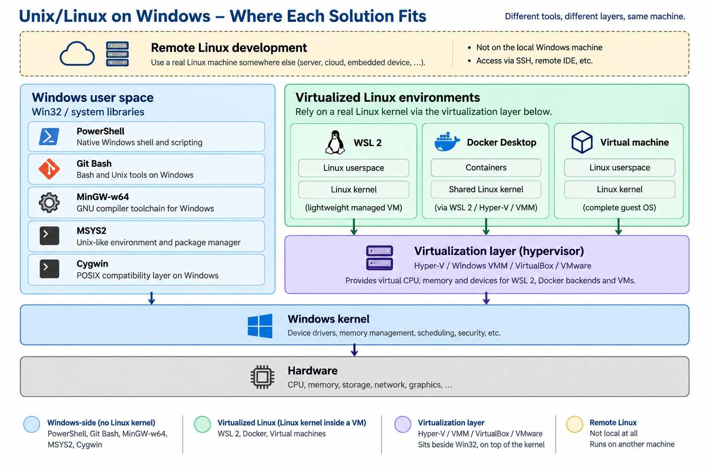

Windows is the default desktop operating system in many companies. Yet modern software development is deeply tied to Linux: production servers, CI/CD pipelines, containers, and even everyday development tools often rely on Bash, GCC, Make, or POSIX APIs.

But what does “running Linux on Windows” actually mean? It could mean using a handful of Unix tools, building software for Linux, or running an entire Linux environment. Many solutions look similar on the surface. After all, they often give you the same familiar Bash prompt. But what happens under the hood can be fundamentally different.

Choosing the right approach comes down to two simple questions: Where will your software ultimately run, and how much of Linux do you actually need?

In this guide, we'll explore the different approaches, moving from least Linux to most Linux; from tools running natively on Windows to a complete Linux system running alongside it.

You can find the [full series](https://kmanu225.gitbook.io/cs/software-engineering/compatibility/linux-on-windows) on my GitBook:
* [**PowerShell**](https://kmanu225.gitbook.io/cs/software-engineering/compatibility/linux-on-windows/powershell)
* [**Git Bash**](https://kmanu225.gitbook.io/cs/software-engineering/compatibility/linux-on-windows/git-bash)
* [**MinGW-w64**](https://kmanu225.gitbook.io/cs/software-engineering/compatibility/linux-on-windows/mingw-w64)
* [**MSYS2**](https://kmanu225.gitbook.io/cs/software-engineering/compatibility/linux-on-windows/msys2)
* [**Cygwin**](https://kmanu225.gitbook.io/cs/software-engineering/compatibility/linux-on-windows/cygwin)
* [**WSL**](https://kmanu225.gitbook.io/cs/software-engineering/compatibility/linux-on-windows/wsl)
* [**Docker and containers**](https://kmanu225.gitbook.io/cs/software-engineering/compatibility/linux-on-windows/docker)
* [**Virtual machines**](https://kmanu225.gitbook.io/cs/software-engineering/compatibility/linux-on-windows/virtual-machines)
* [**QEMU**](https://kmanu225.gitbook.io/cs/software-engineering/compatibility/linux-on-windows/qemu)
* [**Remote Linux development**](https://kmanu225.gitbook.io/cs/software-engineering/compatibility/linux-on-windows/remote)

